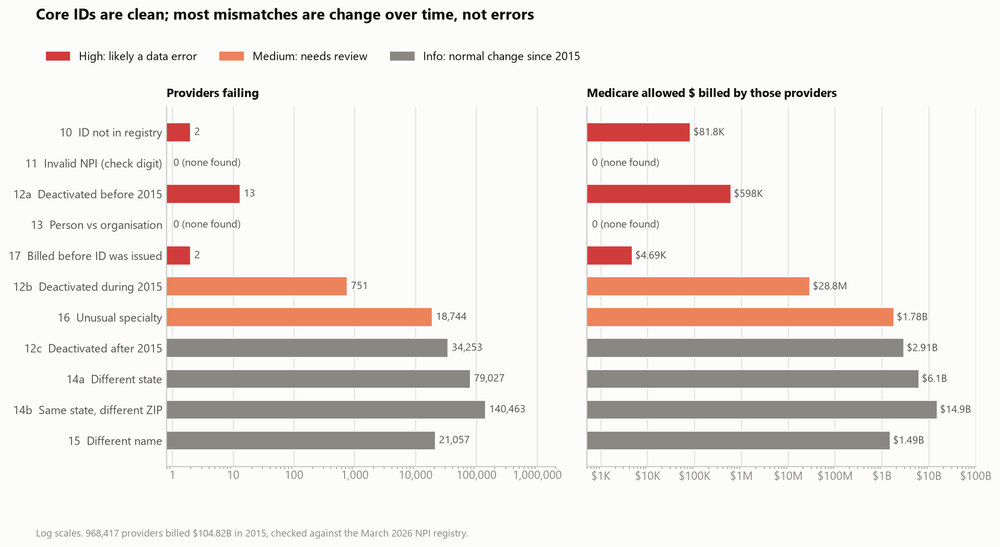
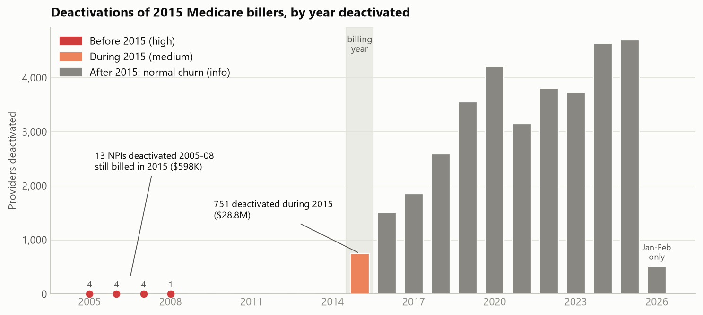
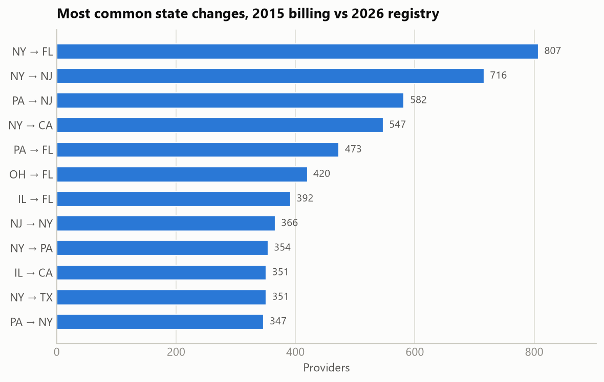
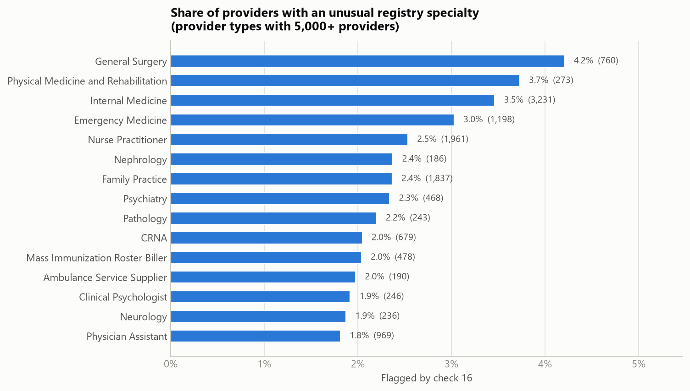

# Medicare NPI Reconciliation

Checks 2015 Medicare billing data against the national provider registry (NPPES), and finds where the two disagree.

**Tools:** SQL (Google BigQuery) · Python (pandas, matplotlib) · Jupyter. **Data:** public CMS Medicare and NPPES tables. **Last full run:** 2026-11-21.

## Purpose

Every US healthcare provider bills under a 10-digit National Provider Identifier (NPI), and the official record of each NPI (name, type, practice location, specialty, status) is kept in the NPPES registry. This project matches every NPI that billed Medicare in 2015 against the registry and reports, for each kind of mismatch, how many providers are affected and how many Medicare dollars they billed.

Mismatched provider data is a common cause of rejected claims, so this is the kind of check a revenue cycle data-operations team runs routinely.

## Key findings

968,417 providers billed Medicare **$104.82 billion** (allowed amount) in 2015. Checked against the March 2026 NPI registry:

- **The core IDs are clean.** No NPI fails the check digit, none has a person/organisation conflict, and only 2 ($81,818) are missing from the registry.
- **13 NPIs were deactivated years before they billed Medicare in 2015** (deactivated 2005–2008, $597,892 allowed). This is the clearest red flag and the first list to investigate.
- **2 NPIs billed Medicare in 2015 but were issued in 2016** ($4,689). Most likely late claims under a newly issued ID, but it needs confirming.
- **751 NPIs were deactivated during 2015 itself** ($28.8M). The yearly data can't show whether the billing came before or after the deactivation, so these need claim-level dates to resolve.
- **Most mismatches are change over time, not errors.** Since 2015, 3.5% of billers have been deactivated (normal churn), 8.5% have moved state, 15% have moved ZIP within their state, and 2.3% have changed their legal name.
- **Organisation name changes trace acquisitions.** Examples include Genoptix → NeoGenomics, Preventice → Boston Scientific and GenomeDx → Veracyte. A billing team would need to update these provider records before submitting new claims.
- **2% of providers have a specialty that's rare for their Medicare provider type** (18,744, $1.78B). This is a signal for review, not proof of an error.





<details>
<summary>More charts: state moves and unusual specialties</summary>



The top moves follow known migration patterns (out of NY, PA, OH and IL towards FL, NJ, CA and TX), which supports reading state mismatches as relocations, not errors.



Broad provider types (General Surgery, Physical Medicine, Internal Medicine) are flagged most, because their providers register under many sub-specialties. Even the highest rate is under 5%.

</details>

Charts are drawn by `notebooks/analysis.ipynb`.

### All checks

From `work.dq_summary` (`sql/20_summary.sql`, output in `results/20_summary.json`).

| Check | Severity | Checked | Failed | % failed | Allowed $ affected |
|---|---|---:|---:|---:|---:|
| 10 ID not in registry | High | 968,417 | 2 | <0.001% | $81,818 |
| 11 Invalid NPI (check digit) | High | 968,417 | 0 | 0% | $0 |
| 12a Deactivated before 2015 | High | 968,415 | 13 | 0.001% | $597,892 |
| 13 Person vs organisation | High | 933,398 | 0 | 0% | $0 |
| 17 Billed before ID was issued | High | 933,398 | 2 | <0.001% | $4,689 |
| 12b Deactivated during 2015 | Medium | 968,415 | 751 | 0.08% | $28.8M |
| 16 Unusual specialty | Medium | 932,737 | 18,744 | 2.01% | $1.78B |
| 12c Deactivated after 2015 | Info | 968,415 | 34,253 | 3.54% | $2.91B |
| 14a Different state | Info | 933,387 | 79,027 | 8.47% | $6.10B |
| 14b Same state, different ZIP | Info | 933,387 | 140,463 | 15.05% | $14.95B |
| 15 Different name | Info | 933,382 | 21,057 | 2.26% | $1.49B |

"Checked" differs by row because each check counts only the providers it could actually test. For example, field comparisons skip deactivated records, whose fields are empty.

## Data sources

All data is public and queried in place in Google BigQuery. Nothing is downloaded.

| Source | BigQuery table | Covers | Rows |
|---|---|---|---:|
| Medicare billing, by provider and procedure | `bigquery-public-data.cms_medicare.physicians_and_other_supplier_2015` | Services in calendar year 2015 | 9,497,891 |
| NPI registry | `bigquery-public-data.nppes.npi_raw` | Snapshot, last modified 2026-03-31 | 9,368,082 |
| Specialty code names | `bigquery-public-data.nppes.healthcare_provider_taxonomy_code_set` | Lookup for taxonomy codes | — |

Table names, column names and types were checked against the live tables on 2026-11-20 (see [SETUP.md](SETUP.md)).

## Decisions

These were fixed before any SQL was written. Every later step follows from them.

### 1. Billing year: 2015 only

2015 is the latest year in the public BigQuery copy. Using a single year also avoids a schema difference: the 2012–13 tables have 28 columns and the 2014–15 tables have 26, so mixing years would need explicit column lists for no analytical gain.

### 2. Registry: `npi_raw`, not `npi_optimized`

| | `npi_raw` (chosen) | `npi_optimized` |
|---|---|---|
| Snapshot | March 2026 | April 2019 |
| Deactivations captured | Up to 2026 | Up to 2019 only |
| Blank values | `NULL` | Sometimes `''` (empty string) |
| Specialty names | Need a join to the taxonomy lookup | Built in |
| Query cost for this project | About the same: BigQuery bills by columns read, and the needed columns are similar in size in both | |

A real data-operations team validates against the current registry, and the deactivation check needs the most complete record of deactivations. The cost of choosing `npi_raw` is one extra join for specialty names.

### 3. Unit of analysis: one row per provider

The Medicare table has one row per NPI, procedure code and place of service. Every check here is about the provider, so the data is first collapsed to one row per NPI.

### 4. Dollar impact = Medicare allowed amount

Impact is measured as `SUM(line_srvc_cnt * average_medicare_allowed_amt)` per NPI: the amount Medicare recognised for that provider's 2015 services. Allowed amount is used instead of submitted charges (which are list prices and vary widely between providers) or payment (which excludes the patient's share).

### 5. The time gap is part of the analysis, not a flaw to hide

The billing is from 2015; the registry is from 2026. A mismatch can mean:

- **a data error**, which should be fixed, or
- **a normal change since 2015**: the provider moved, changed their name, retired or closed.

Every check is rated by which of these it most likely is:

| Severity | Meaning |
|---|---|
| High | Likely a real data error |
| Medium | Could be either |
| Info | Most likely a normal change over time |

### 6. What a mismatch actually measures

The name, address and entity columns in the Medicare file are prefixed `nppes_`: CMS copied them from the registry when it built the 2015 file. So when those fields differ today, the usual explanation is that **the registry changed after 2015**, not that the Medicare data was wrong. The report says this plainly, and the severity ratings reflect it.

### 7. Deactivated NPIs are handled separately

Deactivated records in `npi_raw` keep only the NPI and the dates; name, entity type, state and specialty are all NULL. Comparing those fields for a deactivated NPI would produce a false mismatch every time. So:

- deactivated NPIs are counted once, in the deactivation check, split into deactivated before 2015 (billed long after deactivation: high), during 2015 (order of billing and deactivation unknown: medium) and after 2015 (normal churn: info);
- all field-comparison checks (entity type, state, name, specialty) exclude them.

### 8. Blank and missing are the same thing

Every text field is cleaned with `NULLIF(TRIM(col), '')` before comparing, so an empty string and a NULL are treated identically. Names are uppercased, ZIP codes cut to 5 digits.

### 9. Sandbox constraints

The project runs in the free BigQuery sandbox (no billing account). That means:

- Result tables are built with `CREATE OR REPLACE TABLE ... AS SELECT`; INSERT, UPDATE, DELETE and MERGE aren't available.
- Saved tables expire after 60 days. The SQL files in `sql/` are the permanent record; saved tables are only a cache.
- Query budget for the whole project: under 50 GB processed, about 5% of the 1 TiB monthly allowance. The large public tables are each read once to build small working tables, and every later query reads the working tables.

## How to run it

The whole pipeline is SQL in BigQuery, plus one notebook for the charts. Allow about an hour for a full run from scratch.

### What you need

- A Google account with a BigQuery project. The free [BigQuery sandbox](https://cloud.google.com/bigquery/docs/sandbox) is enough: no billing account, and the whole run uses about 5 GB of the free 1 TiB a month.
- Python 3.13 or newer, only for the charts.

### 1. Create the project and the `work` dataset

1. In the [BigQuery console](https://console.cloud.google.com/bigquery), create a project. This repo uses the project ID `npi-reconciliation`.
2. Open a query tab and run:
   ```sql
   CREATE SCHEMA `npi-reconciliation.work` OPTIONS (location = 'US');
   ```
   The location must be `US`, the same as the public datasets, or joins fail.

**Using a different project ID?** Find and replace `npi-reconciliation` in every file in `sql/` and in `notebooks/bq.py`.

### 2. Run the SQL files in order

For each file: open it in an editor, copy everything, paste it into a new BigQuery query tab, check the **"This query will process…"** estimate at the top right, then click **Run**. Files with several statements show each result under **View results**.

| Order | File | Builds | Processes | Check before moving on |
|---:|---|---|---|---|
| 1 | `01_medicare_providers.sql` | `work.medicare_providers_2015` | ~1–1.5 GB | 968,417 rows, one per NPI |
| 2 | `02a_taxonomy_metadata.sql` | nothing (metadata) | ~10 MB | Lookup columns are `code`, `grouping`, `classification`… |
| 3 | `02b_nppes_base.sql` | `work.nppes_base` | under 2.42 GB; **the one big scan** | Finishes without error |
| 4 | `02c_nppes_slim.sql` | `work.nppes_slim` | small | Same row count as `nppes_base` |
| 5 | `02d_validate_nppes.sql` | nothing | small | `registry_rows` = `registry_unique_npis`; `active_without_entity_type` = 0 |
| 6 | `03_profile.sql` *(optional)* | nothing | small | Profiles both tables; see [About the data](#about-the-data) |
| 7 | `10_…` to `17_…` | `work.chk_10_…` to `work.chk_17_…` | small each | `14_…`'s second result (unmapped state values) must be empty |
| 8 | `20_summary.sql` | `work.dq_summary` | small | 11 rows |

Only steps 1 and 3 read the large public tables. Everything after reads the small `work` tables.

If the guard query in `14_location_mismatch.sql` returns rows, the registry has a new state spelling. Add it to `registry_fixes` in that file and rerun it.

### 3. Draw the charts

From the repository folder, in PowerShell:

```
python -m venv .venv
.venv\Scripts\python.exe -m pip install -r requirements.txt
.venv\Scripts\python.exe -m ipykernel install --user --name medicare-npi --display-name "Python (medicare-npi)"
.venv\Scripts\python.exe notebooks\bq.py
```

The last command tests the connection. The first time, it opens a browser to sign in to Google and approve BigQuery access. It should print the 11 summary rows.

Then either open `notebooks/analysis.ipynb` in VS Code, choose the **Python (medicare-npi)** kernel and click **Run All**, or run it from the terminal:

```
.venv\Scripts\jupyter.exe nbconvert --to notebook --execute --inplace notebooks\analysis.ipynb
```

Charts are written to `results/charts/`.

### Rerunning later

Tables in the sandbox expire 60 days after they're created. If BigQuery says a `work` table isn't found, rerun section 2 from the top.

## Check reference

What each check tests, and what a revenue cycle team would do with a failure.

| Check | File | Rule | Severity | Likely cause | What to do with a failure |
|---|---|---|---|---|---|
| 10 ID not in registry | `10_not_in_registry.sql` | Billing NPI has no registry record | High | NPI issued in error and removed, or a data error | Look the NPI up on the [NPPES NPI Registry](https://npiregistry.cms.hhs.gov). If it isn't there, hold claims and get the correct NPI from the provider |
| 11 Invalid NPI | `11_invalid_check_digit.sql` | NPI isn't 10 digits, or fails the Luhn check digit (with prefix 80840) | High | Typing error | Reject at data entry; correct the NPI with the provider |
| 12a Deactivated before 2015 | `12_deactivated.sql` | Deactivated before 1 Jan 2015, billed in 2015 | High | Billing under an inactive ID | Stop claims under this NPI; review the billing with compliance |
| 12b Deactivated during 2015 | `12_deactivated.sql` | Deactivated during 2015 | Medium | Normal deactivation, or billing after it | Pull claim-level service dates; treat any service after the deactivation date as 12a |
| 12c Deactivated after 2015 | `12_deactivated.sql` | Deactivated after 2015 | Info | Retirement, death, practice closed | Mark the provider inactive in the provider master; check `replacement_npi` |
| 13 Person vs organisation | `13_entity_mismatch.sql` | Medicare I/O disagrees with registry 1/2 | High | Data error | Correct the entity type in the provider master; claims under the wrong type are rejected |
| 14a Different state | `14_location_mismatch.sql` | Standardised practice state differs | Info | Provider moved | Update the practice location; check the provider's Medicare enrollment matches |
| 14b Different ZIP | `14_location_mismatch.sql` | Same state, different 5-digit ZIP | Info | Moved within the state | As 14a |
| 15 Different name | `15_name_mismatch.sql` | Cleaned legal name differs, allowing for truncation, compound names and small typos | Info | Marriage; organisation renamed or acquired | Update the legal name; for organisations, confirm the change of ownership paperwork |
| 16 Unusual specialty | `16_specialty_mismatch.sql` | Registry specialty held by <1% of the same Medicare provider type (types with 100+ providers) | Medium | Specialty changed, or a wrong taxonomy code | Review the taxonomy code; payers can deny claims when it doesn't match enrollment |
| 17 Billed before ID issued | `17_issued_after_billing.sql` | Registry issue date after 31 Dec 2015 | High | Late claims under a newly issued ID, or a date error | Check the issue date on the NPPES registry against the claim service dates |

## Repository layout

```
medicare-npi-reconciliation/
├── sql/                  # the pipeline, run in number order (see How to run it)
├── notebooks/
│   ├── analysis.ipynb    # charts
│   └── bq.py             # BigQuery sign-in and query helper
├── results/
│   ├── charts/           # chart images used in this README
│   └── *.json            # saved query results, named after the SQL file that produced them
│                         # (results that name individual providers are kept out of the repo)
├── requirements.txt      # Python libraries, exact versions
├── SETUP.md              # BigQuery project, confirmed table and column names, Python setup
├── PLAN.md               # the original project plan
└── README.md
```

## Working tables

Built in the project's `work` dataset (US multi-region). The SQL in `sql/` rebuilds each one.

| Table | Built by | Rows | Check |
|---|---|---:|---|
| `work.medicare_providers_2015` | `sql/01_medicare_providers.sql` | 968,417 | One row per NPI (rows = distinct NPIs = 968,417). Total allowed: $104.82 billion |
| `work.nppes_base` | `sql/02b_nppes_base.sql` | 968,415 | Registry rows for the Medicare billers; one row per NPI |
| `work.nppes_slim` | `sql/02c_nppes_slim.sql` | 968,415 | Same rows as `nppes_base` (the name join added none) |

Validation of the registry table (`sql/02d_validate_nppes.sql`, output in `results/02d_validate_nppes.json`):

| Measure | Count | Note |
|---|---:|---|
| Medicare billers found in the registry | 968,415 of 968,417 | 2 not found |
| Active | 930,771 | 96.1% |
| Deactivated | 35,017 | 3.6% |
| Reactivated | 2,627 | 0.3% |
| Primary specialty from the `Y` switch | 933,398 | Every active and reactivated provider; the first-code fallback was never needed |
| Specialty code with no name in the 2020 lookup | 502 | 0.05%; codes newer than the lookup |
| Not deactivated, but missing entity type or specialty | 0 | Confirms decision 7: only deactivated records are emptied |

## About the data

From profiling both working tables (`sql/03_profile.sql`, outputs in `results/03_q*.json`).

**The Medicare side is clean and consistent.**
- Every NPI has exactly one name, state and provider type across all its rows, so collapsing to one row per provider lost nothing.
- No blank names, states, ZIPs or provider types. Every NPI is 10 digits. Only 18 ZIP codes aren't 5 digits.
- 906,397 individuals and 62,020 organisations, across 91 provider types and 61 state codes. The 61 are the 50 states, DC, 5 territories, 3 military codes (AA, AE, AP), plus `XX` (unknown, 8 providers) and `ZZ` (foreign, 66).
- Dollars are heavily skewed. Allowed amount per provider: median **$37,513**, 99th percentile **$1.02M**, maximum **$194.8M**. Charts need log scales or medians, not averages.

**Person vs. organisation agrees everywhere it can be compared.** Every one of the 933,398 active or reactivated registry records has the same entity type as its Medicare record (I = 1, O = 2). Check 13 confirmed zero mismatches.

**Registry state is free text, not a code list.** The registry side has 110 distinct state values against Medicare's 61. Besides the standard codes there are full names (`FLORIDA`, `PUERTO RICO` ×14, `NC - NORTH CAROLINA`), cities (`GUAYNABO`, `SAN DIEGO`), and foreign regions (`ONTARIO`, `TOKYO`, `KARNATAKA`). The state check must standardise these first, or it will report false mismatches.

**Deactivations: 35,017 billers, $2.94 billion allowed.**
- 764 were deactivated by the end of 2015: 751 during 2015 ($28.8M) and 13 in 2005–2008 ($0.6M).
- 34,253 were deactivated later, rising from about 1,500 a year in 2016 to about 4,700 a year in 2024–25. That's normal churn: retirement, death, practices closing.
- Of the 2,627 reactivated NPIs, 1,896 were deactivated in 2006. That's most likely a bulk registry correction, not individual provider events.
- **Deactivation reason codes are blank** for every record in `npi_raw`, so deactivations can't be split by cause (death, fraud, etc.).

**Smaller oddities to follow up:**
- 2 NPIs billed Medicare in 2015 but are missing from the registry (both individuals, $81,818).
- 2 NPIs have an issue date after 2015 but billed Medicare in 2015. The latest issue date among all billers is 2016-03-01.
- 16 active individuals have no last name and 10 no first name; 1 record has no state.
- 12 records list a replacement NPI.

## Known limitations

- **Small providers are missing from the billing data.** CMS leaves out any provider/procedure combination with fewer than 11 Medicare patients, to protect privacy. Some providers therefore appear with only part of their billing, and some not at all.
- **One registry snapshot.** `npi_raw` shows each NPI as it is in March 2026, not its history. A provider who moved in 2016 and back in 2020 looks unchanged.
- **Billing dates are yearly, not per claim.** The Medicare file sums a whole year, so for an NPI deactivated during 2015 it's impossible to tell whether the services came before or after the deactivation.
- **No deactivation reasons.** `npi_deactivation_reason_code` is blank throughout `npi_raw`.
- **Specialty comparison is approximate.** Medicare's `provider_type` and the registry's taxonomy codes use different vocabularies, so that check flags specialties that are rare (<1%) for the provider type, rather than comparing the two directly. Its thresholds are judgement calls.
